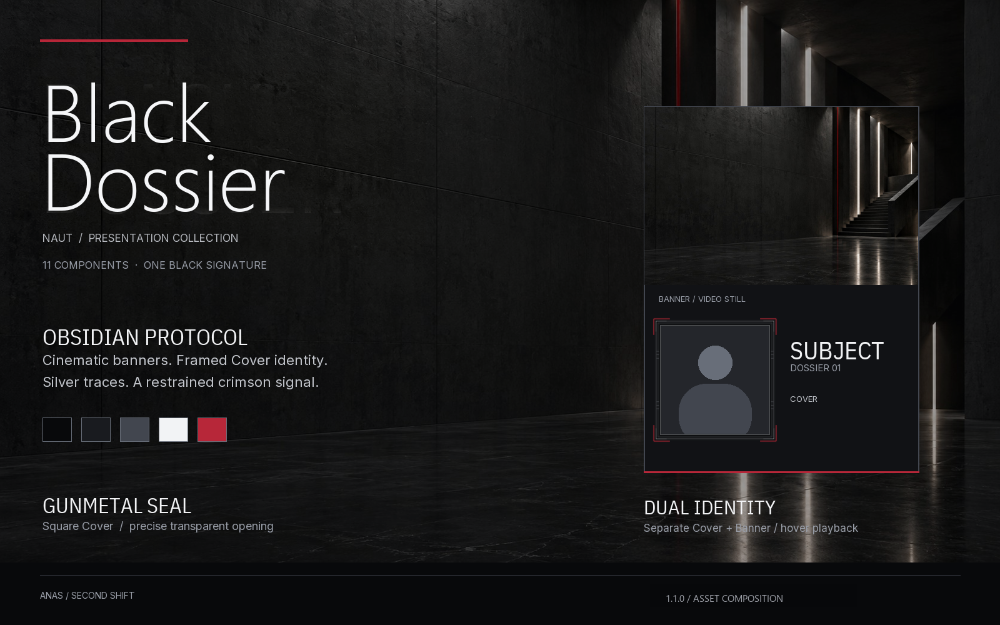
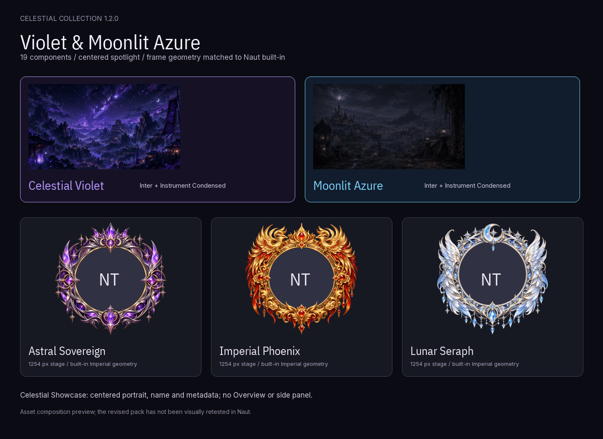
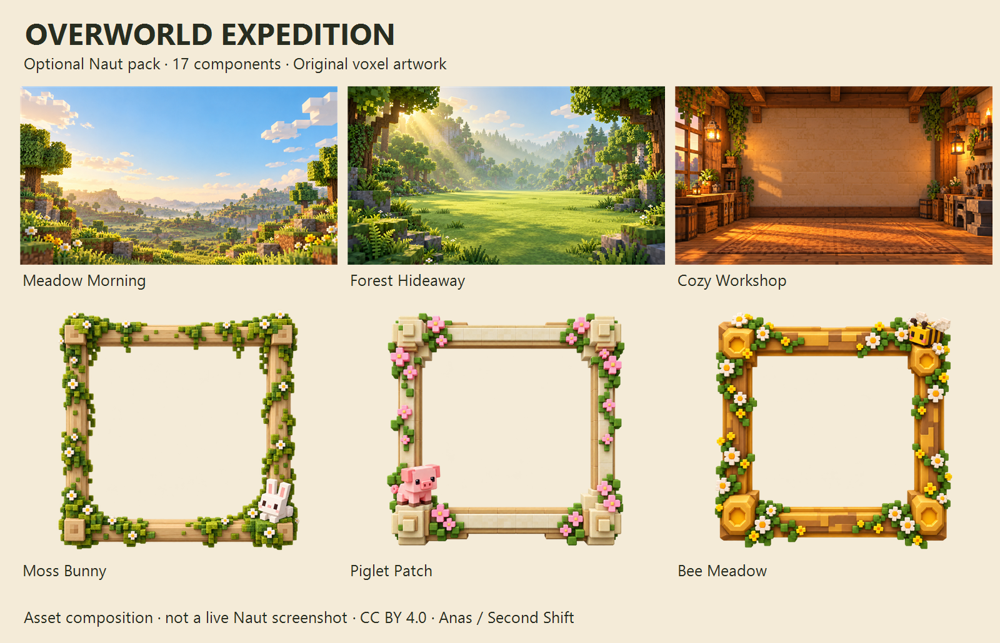

# Official optional presentation packs

The packs below contain independent definitions, not mandatory all-category bundles. Installation never changes user selections. The versions below are distributed as reviewed .ntpack archives through the independent optional-pack publishing channel.

## Black Dossier - 2.0.0 source

Nine distinct definitions: Obsidian Protocol Theme, Dossier Type, Operations Desk, Opening Brief, Dual Identity Card, Subject Dossier Profile, Obsidian Atrium Backdrop, Gunmetal Seal Frame, and Signal Trace Effect. The gallery and media-layout definitions were removed because the engine already offers their basic layout mechanisms.

[Download 2.0.0](https://secondshift-dv.github.io/naut/packs/black-dossier-2.0.0.ntpack) | [Source and setup](black-dossier/README.md) | [Provenance](black-dossier/PROVENANCE.txt) | [Previous 1.1.0 archive](https://secondshift-dv.github.io/naut/packs/black-dossier-1.1.0.ntpack)

## Nightfall Murim - 2.0.0 source

An original nighttime martial-arts manhwa / jianghu atmosphere: sect halls, moonlight, restrained lantern-gold and jade, disciplined disciple records, scroll media and blade-aura motion. Eleven definitions: two Themes plus Home, Spotlight, Profile Card, Profile, Media, Backdrop, Effect, Cover Frame and Control Style. Overlapping typography, gallery, backdrop, frame and control alternatives have been removed.

The historical folder slug celestial and technical pack ID neuterradise.celestial are preserved for upgrades, not used as the user-facing name.

[Download 2.0.0](https://secondshift-dv.github.io/naut/packs/celestial-2.0.0.ntpack) | [Source/setup](celestial/README.txt) | [Manifest](celestial/pack.json) | [Provenance](celestial/PROVENANCE.txt) | [Previous 1.3.0 archive](https://secondshift-dv.github.io/naut/packs/celestial-1.3.0.ntpack)

## Voxel Playground - 2.0.0 source

An original voxel sandbox inspired by the building/exploring possibilities of Minecraft and Roblox without third-party game assets, brands or characters. Twelve definitions: a sky-and-grass Theme, pixel-heading Typography, block-built Controls, Home, Spotlight, Card, Profile, Media, two scope-specific Backdrops, Pixel Dust Effect, and one piglet Cover Frame. Repetitive layouts, effects and ornamental frames are removed.

The historical folder slug overworld-expedition and technical pack ID naut.overworld-expedition remain stable for upgrades.

[Download 2.0.0](https://secondshift-dv.github.io/naut/packs/overworld-expedition-2.0.0.ntpack) | [Source/setup](overworld-expedition/README.md) | [Manifest](overworld-expedition/pack.json) | [Provenance](overworld-expedition/PROVENANCE.txt) | [Previous 1.1.0 archive](https://secondshift-dv.github.io/naut/packs/overworld-expedition-1.1.0.ntpack)

## Installation and fallback

Install a folder or published archive through Settings > Presentation > Packs / Advanced. Choose global Theme, Typography and Controls in Settings > Appearance. Choose Home/Profile-scoped components in their Customize panels, and Profile Card / Card Effect in Customize Card. Save the selection; the Presentation Library is for browsing, not selecting.

Surviving definition IDs are unchanged. When a previously selected definition was removed, Naut uses its established built-in fallback, without changing Vault media.

[Installation and updates](../docs/pack-collection.md) | [Contribute a pack](../docs/contributing-packs.md)
