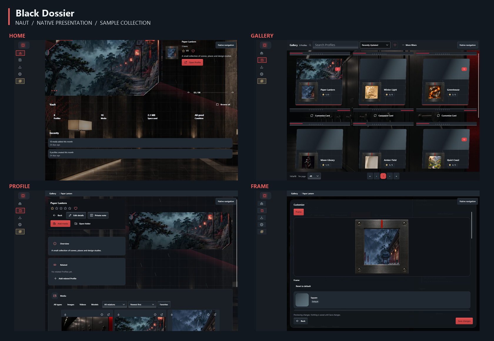
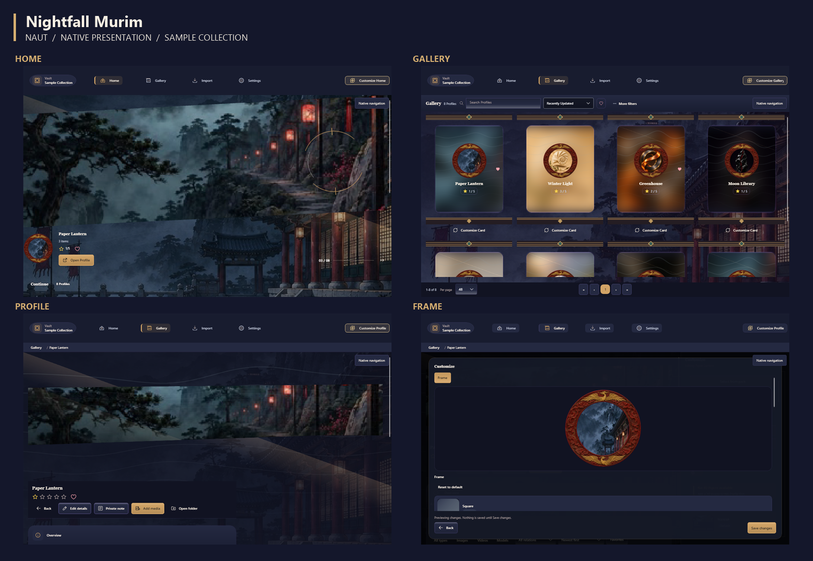
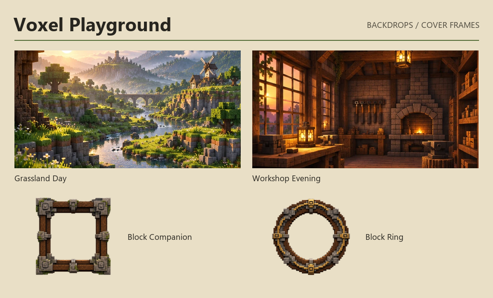
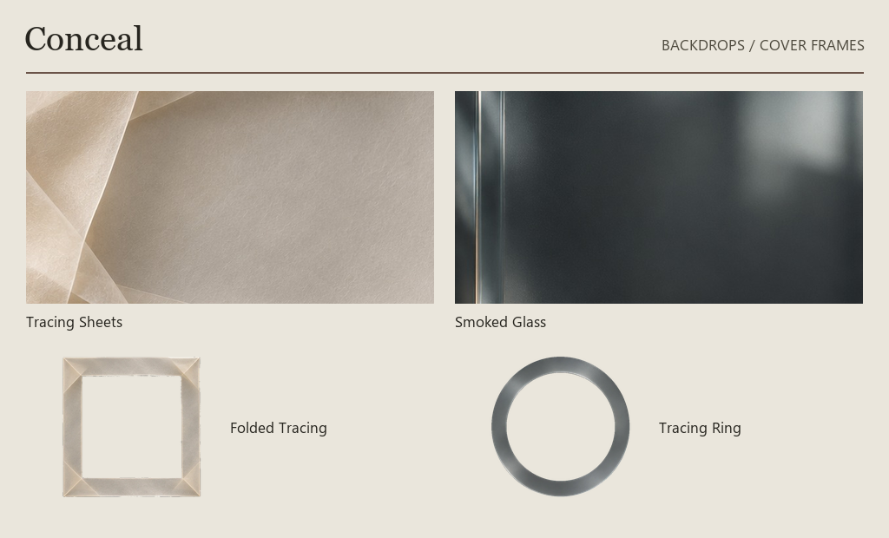

# Official optional presentation packs

Install a pack from **Settings → Presentation → Packs / Advanced → Install from
file**. Use **Replace** to upgrade a pack with the same ID. Installation adds
choices. Pick and save Home, Profile and Card options in their Customize
panels. Choose global themes, typography and controls in Settings → Appearance.

This collection targets Naut v0.0.26. Each pack offers two Cover Frames and two
Backdrops. Select each backdrop in
Home or Profile Customize and save them independently. The images below show
the pack artwork and frame designs.

## Black Dossier - 2.1.0 source

In Home Customize, choose **Operations Desk** and **Opening Brief**. Backdrops are **Obsidian Atrium** and
**Steel Evidence Archive**. Frames are **Gunmetal Seal** and **Redline Steel**.

[Download 2.1.0](https://secondshift-dv.github.io/naut/packs/black-dossier-2.1.0.ntpack) | [Setup and components](black-dossier/README.md) | [2.0.0 archive](https://secondshift-dv.github.io/naut/packs/black-dossier-2.0.0.ntpack)

## Nightfall Murim - 2.1.0 source

In Home Customize, choose **Sect Hall** and **Moonlit Duel**. Backdrops are **Moonlit Sect Court** and
**Lantern Pass**. Frames are **Vermilion Phoenix Seal** and **Jade Lacquer Seal**.

[Download 2.1.0](https://secondshift-dv.github.io/naut/packs/celestial-2.1.0.ntpack) | [Setup and components](celestial/README.txt) | [2.0.0 archive](https://secondshift-dv.github.io/naut/packs/celestial-2.0.0.ntpack)

## Voxel Playground - 2.1.0 source

In Home Customize, choose **Creative Hub** and **World Portal**. Backdrops are **Grassland Day** and
**Workshop Evening**. Frames are **Block Companion** and **Block Ring**.

[Download 2.1.0](https://secondshift-dv.github.io/naut/packs/overworld-expedition-2.1.0.ntpack) | [Setup and components](overworld-expedition/README.md) | [2.0.0 archive](https://secondshift-dv.github.io/naut/packs/overworld-expedition-2.0.0.ntpack)

## Conceal - 2.1.0 source

In Home Customize, choose **Tracing Index** and **Under Glass**. Backdrops are **Tracing Sheets** and
**Smoked Glass**. Frames are **Folded Tracing** and **Tracing Ring**.

[Download 2.1.0](https://secondshift-dv.github.io/naut/packs/conceal-2.1.0.ntpack) | [Setup and components](conceal/README.md)

## Upgrading

Existing IDs continue to resolve when the component is present in the new
archive. Retired selections use Naut's built-in fallback. Conceal retires
Wide Keepsake; install Voxel Playground for the wide World Keepsake Card.

Earlier archives remain available for [Black Dossier 1.1.0](https://secondshift-dv.github.io/naut/packs/black-dossier-1.1.0.ntpack),
[Nightfall Murim 1.3.0](https://secondshift-dv.github.io/naut/packs/celestial-1.3.0.ntpack),
and [Voxel Playground 1.1.0](https://secondshift-dv.github.io/naut/packs/overworld-expedition-1.1.0.ntpack).

Original pack artwork and definitions by **secondshift-dv**, CC BY 4.0.
Bundled assets retain their notices.

[Checksums](https://secondshift-dv.github.io/naut/packs/checksums.json) ·
[Installation and updates](../docs/pack-collection.md) ·
[Contribute a pack](../docs/contributing-packs.md)
